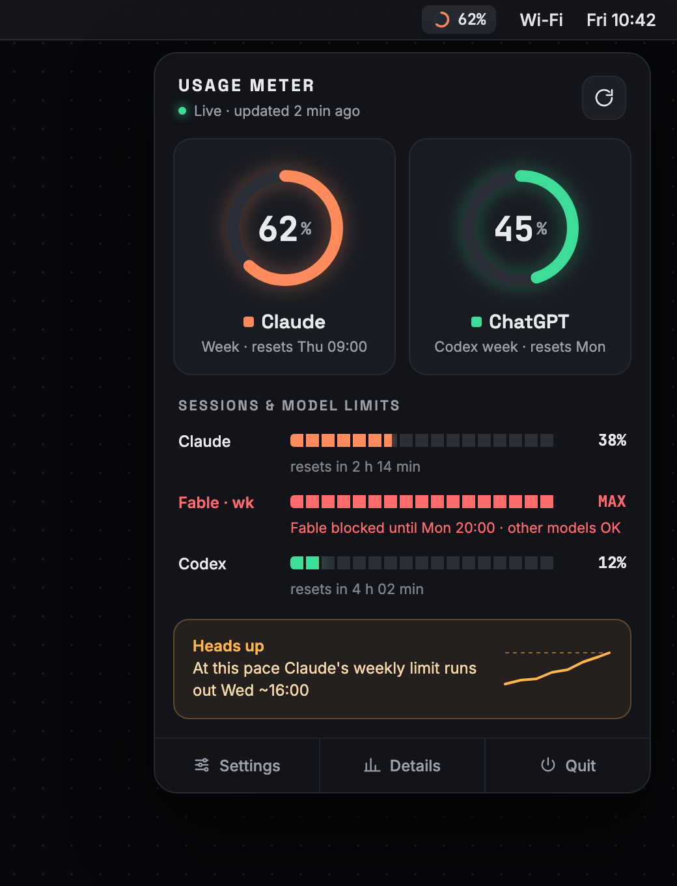
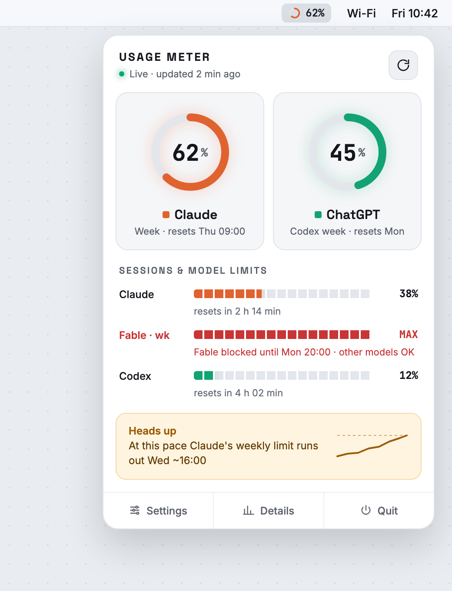
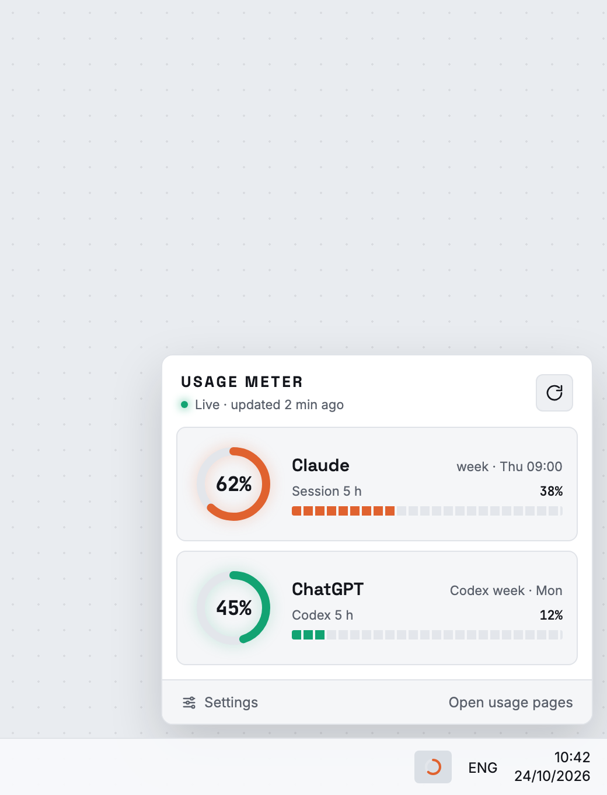
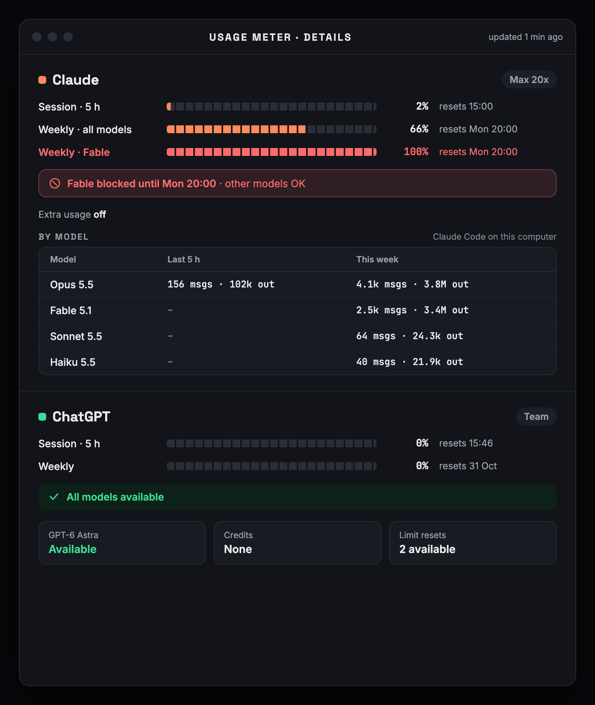

# Usage Meter

Claude and ChatGPT plan limits in the Mac menu bar and the Windows tray: the
5-hour session, the weekly limit, per-model weekly limits (e.g. Fable), and
per-model activity from Claude Code and Codex. Alerts at 80% (configurable),
when a limit is hit and when it resets. Light, dark or follow the system;
English or Dutch, or follow the system language.

<p align="center">
  
  
  
</p>
<p align="center">
  
</p>

<sub>Design mockups with sample numbers; the app shows your own.</sub>

Translations live in `src/i18n.ts` (the window) and `src-tauri/src/i18n.rs`
(notifications and the tray menu). To add a language, copy the `en` block in
`src/i18n.ts`, add it to `LANGS` in `src/main.ts`, and add its texts to `i18n.rs`.

Free to build and distribute: self-signed builds, installed with a one-line
script, updates published as GitHub releases.

## Install

Step-by-step guide for colleagues, no technical knowledge needed:
**[INSTALL.md](INSTALL.md)** (English) · **[INSTALL.nl.md](INSTALL.nl.md)** (Nederlands).

Short version, once Claude Code and/or Codex are signed in on the computer:

```sh
# Mac (Terminal)
curl -fsSL https://raw.githubusercontent.com/nealwebdev/usage-meter/main/scripts/install-mac.sh | sh
```

```powershell
# Windows (PowerShell)
irm https://raw.githubusercontent.com/nealwebdev/usage-meter/main/scripts/install-windows.ps1 | iex
```

The app opens at login and updates itself. Builds aren't signed with a paid
certificate, so if someone downloads the installer in a browser instead,
macOS asks once to allow it (System Settings › Privacy & Security › Open
Anyway) and Windows shows "More info › Run anyway". The scripts avoid that.

## Where the numbers come from

| What | Source |
|---|---|
| Claude session, weekly, per-model weekly, extra usage | `api.anthropic.com/api/oauth/usage` with Claude Code's login (macOS Keychain `Claude Code-credentials`, or `~/.claude/.credentials.json`) |
| Claude per-model messages and tokens | Claude Code's transcripts in `~/.claude/projects` (this computer only) |
| ChatGPT/Codex session, weekly, model availability, credits, limit resets | `chatgpt.com/backend-api/wham/usage` with `~/.codex/auth.json`; falls back to the last Codex session log |
| Codex per-model turns and tokens | `~/.codex/sessions` |

Both endpoints are unofficial (the same ones claude.ai's usage page and Codex
`/status` use). If one changes shape, fix `src-tauri/src/claude.rs` or
`codex.rs` and publish a release. Polling is every 5 minutes at most; they
answer HTTP 429 when polled harder, and the app then backs off for 10 minutes.

Only numbers are cached (`state.json` in the app cache folder). Logins are
read from the CLIs' own stores on each refresh and never copied.

## Troubleshooting

Print what the app sees, as JSON:

- Mac: `"/Applications/Usage Meter.app/Contents/MacOS/usage-meter" --print`
- Windows: `& "$env:LOCALAPPDATA\Usage Meter\usage-meter.exe" --print`

## Develop

Needs Node 20+ and Rust (`rustup`).

```sh
npm install
npm run tauri dev          # run with hot reload
npm run tauri build        # build .app/.dmg (Mac) or the installer (Windows)
cd src-tauri && cargo run -- --print   # just the readers, no UI
```

Code map:

- `src/` the popover UI (overview, details, settings); plain TypeScript, no framework
- `src-tauri/src/claude.rs`, `codex.rs` the two readers
- `src-tauri/src/logs.rs` per-model activity from the CLI logs
- `src-tauri/src/engine.rs` polling, back-off, alerts
- `src-tauri/src/tray.rs` menu bar / tray icon and popover placement
- `scripts/make-icons.py` draws the icons (`npm run icons` regenerates them)

## Release an update

1. `node scripts/bump.mjs 0.1.1`
2. Commit, then `git tag v0.1.1 && git push && git push origin v0.1.1`
3. GitHub Actions builds Mac (universal) and Windows, signs the update files
   and publishes the release with `latest.json`. Installed apps check every
   6 hours and on start, download in the background and offer a restart.

One-time setup for the repo:

- The repo must be **public** so installed apps can download updates without a token.
- Add the secret `TAURI_SIGNING_PRIVATE_KEY` with the contents of
  `~/.tauri/usage-meter.key` (`gh secret set TAURI_SIGNING_PRIVATE_KEY < ~/.tauri/usage-meter.key`).
  Keep a backup of that key: without it, installed apps can't receive updates.
- If the repo isn't `nealwebdev/usage-meter`, change the updater URL in
  `src-tauri/tauri.conf.json` and the repo name in both install scripts.
